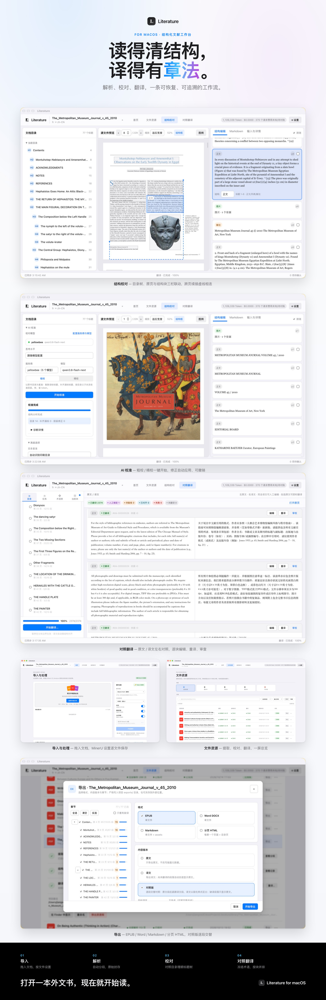
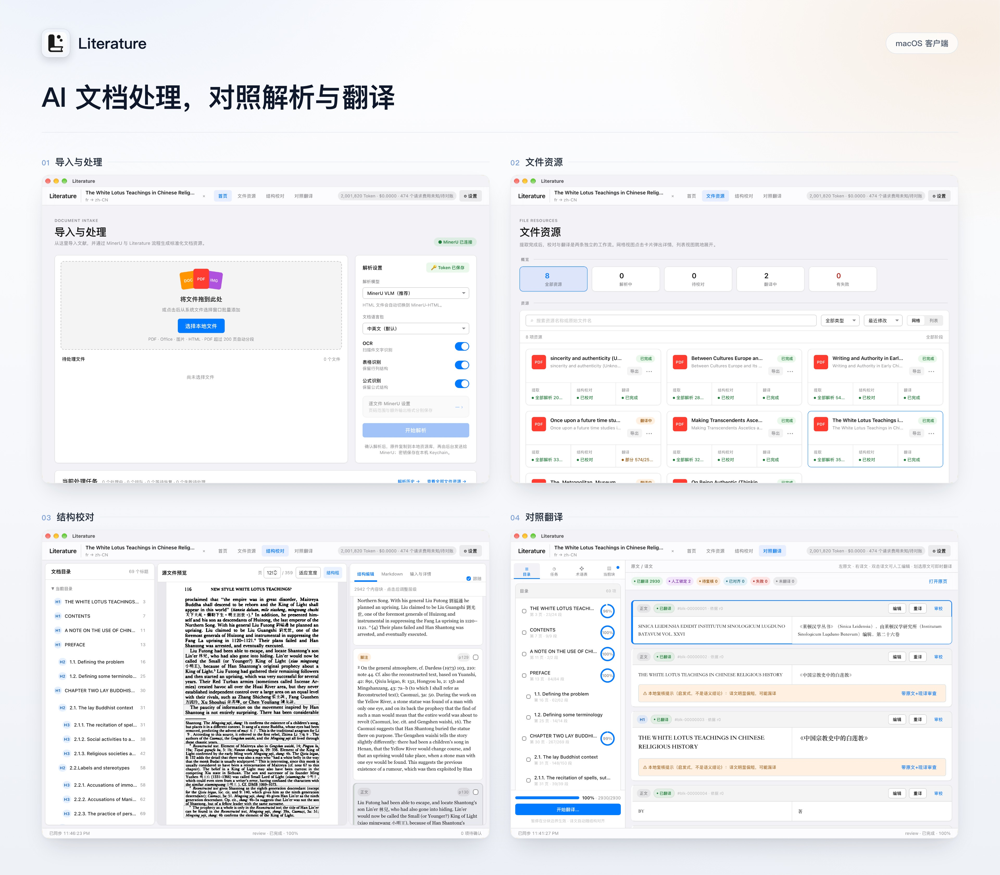
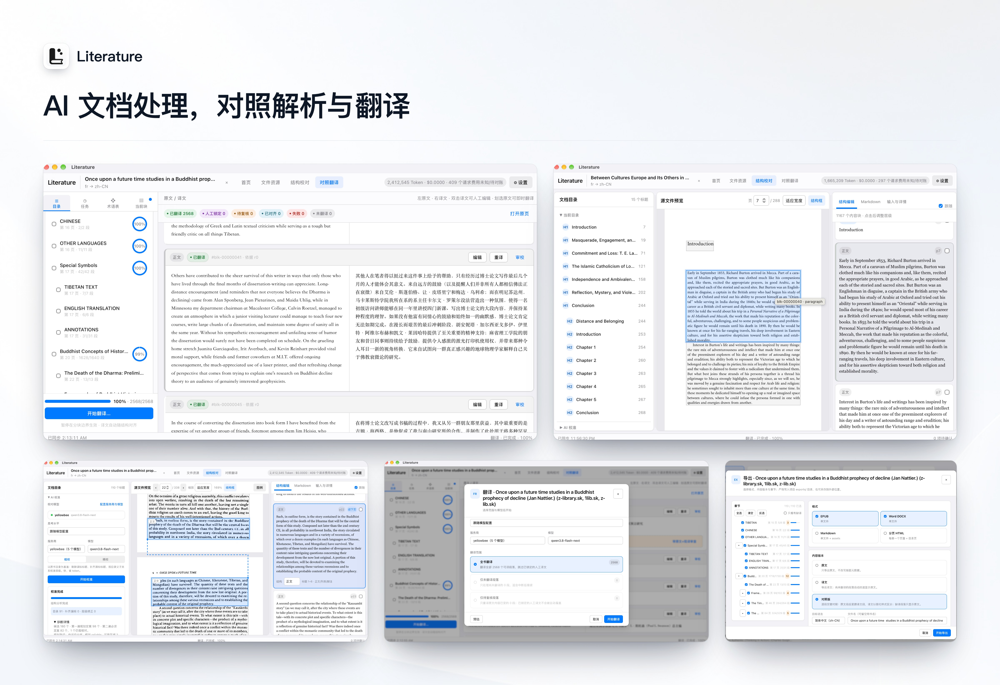

# Literature

<div align="center">
  
</div>

**Literature** 是一款本地优先的结构化文献工作台：把一本书或一篇文献从「原始文件」变成「可阅读的双语成品」，全程数据可追溯、可恢复。

- **解析** — 交给 [MinerU](https://github.com/opendatalab/MinerU)，支持 PDF（自动分段）、Office、图片、HTML
- **校对** — AI 对照原书目录校准标题层级，跨页续接可视化，全部修改可撤销
- **翻译** — 结构化对照翻译：原文一段、译文一段，术语表冻结、断点续译、人工锁定
- **导出** — EPUB / Word DOCX / Markdown / 分页 HTML，原文、译文或对照版，出版级排版

## 下载

| 平台 | 文件 | 安装方式 |
|---|---|---|
| **Windows** x64 | [Literature_0.1.1_x64-setup.exe](https://github.com/carrot123zhou/Literature/releases/download/v0.1.1/Literature_0.1.1_x64-setup.exe) | 双击安装（NSIS，按当前用户安装，无需管理员权限） |
| **macOS** Apple Silicon | [Literature-0.1.1-macos-arm64.zip](https://github.com/carrot123zhou/Literature/releases/download/v0.1.1/Literature-0.1.1-macos-arm64.zip) | 解压后把 `Literature.app` 拖入「应用程序」；首次打开请右键 → 打开 |

所有版本均内置 Python 后端与全部前端资源，运行**不需要** Python、Node、浏览器或源码仓库。其他版本见 [Releases](https://github.com/carrot123zhou/Literature/releases)。

> 需要 MinerU API Token 才能解析文档；翻译需要配置任一 OpenAI 兼容模型服务（OpenAI、DeepSeek、智谱 GLM、Qwen/百炼或自建服务）。两者都在应用内「设置」中完成。

## 界面

| | |
|---|---|
|  |  |

左：导入、解析、结构校对、对照翻译四页合一总览；右：导入与解析设置。

## 工作流

```text
① 导入          ② 解析（MinerU）      ③ 结构校对            ④ 对照翻译 → ⑤ 导出
拖入/选择文件 → PDF 自动分段、页眉   → AI 对照原书目录校准  → 逐段对照、术语表、
逐文件设置      页脚识别、raw 封存      标题层级，可撤销        断点续译、人工锁定
```

1. **导入与解析**：首页拖入或选择文件，逐个设置页码范围与解析参数；大型 PDF 自动分段，进度可恢复，失败只重试失败分段。
2. **结构校对**：AI 读取目录页与全文标题，给出误标/漏标/层级差分建议，自动应用且可撤销；原页 bbox 与结构块双向定位，跨页续接用虚线连接。
3. **对照翻译**：全书、选章或选定段落；小块并发 + 前后文衔接；人工编辑自动锁定；真实记录 Token 用量与费用。
4. **导出**：EPUB 采用出版级排版（两端对齐、首行缩进、serif 字体栈、原书封面），导航目录支持原文·译文对照；导出记录可随时重命名或删除。

## 使用

打开应用后，首页通过系统文件选择器或拖入文件加入队列。支持 PDF、DOC/DOCX、PPT/PPTX、XLS/XLSX、PNG/JPG、HTML。

设置中的「本地资源与存储」可打开资源库、运行数据和日志，也可选择另一资源库位置（重启生效，原库不自动移动）。项目内原件可另存到外部位置。

## 数据与资源

```text
原件 → MinerU raw（只读封存、SHA-256 校验）
     → document/document.json（长期主数据，稳定 block/cell ID）
     → translations/<locale>/translation.json（译文按稳定 ID 挂接）
     → exports/（导出产物，可管理）
```

- raw 层永不改写；译文、校对补丁、导出全部从规范文档派生，随时可重建。
- 新机器默认使用 `~/Library/Application Support/Literature/library/`（Windows 为 `%APPDATA%\Literature`）；已有资源库可在设置中切换，本机文献不会搬迁或清除。
- API Key 只进 macOS Keychain / 用户目录密钥文件，不进项目、日志或导出。

目录与清理规则见 [资源管理](docs/RESOURCE_MANAGEMENT.md)；当前验收事实见 [开发日志](docs/DEVELOPMENT_LOG.md)；数据约束见 [架构](docs/ARCHITECTURE.md)。

## 开发与构建

```bash
python3.12 -m venv .venv
.venv/bin/pip install -e '.[dev,packaging]'
pnpm --dir frontend install --frozen-lockfile
pnpm --dir frontend desktop:dev        # 开发客户端（自动启动 .venv 后端）
```

生产构建：

```bash
./scripts/build_desktop.sh             # macOS：sidecar + 前端 + Tauri + adhoc 签名，安装到 launcher/
```

Windows 安装包由 GitHub Actions 在 `windows-latest` 上构建（[`.github/workflows/windows.yml`](.github/workflows/windows.yml)）：打 `v*` 标签或手动触发即可，产物自动附到 Release。

浏览器仅用于调试：

```bash
LITERATURE_SESSION_TOKEN=literature-dev .venv/bin/python -m literature.api
VITE_LITERATURE_TOKEN=literature-dev pnpm --dir frontend dev
```

详细流程见 [macOS 打包](docs/PACKAGING.md)。

## 致谢

- [MinerU](https://github.com/opendatalab/MinerU)（OpenDataLab）——Literature 的文档解析引擎。MinerU 负责将 PDF / Office / 图片 / HTML 转为带版面结构的 Markdown 与 JSON，Literature 在其不可变输出之上构建规范文档、结构校对与翻译工作流。感谢 MinerU 项目与社区的出色工作。

## 许可

MIT（见 [pyproject.toml](pyproject.toml)）。旧 Litera 项目保持独立，不在本仓库范围内。
