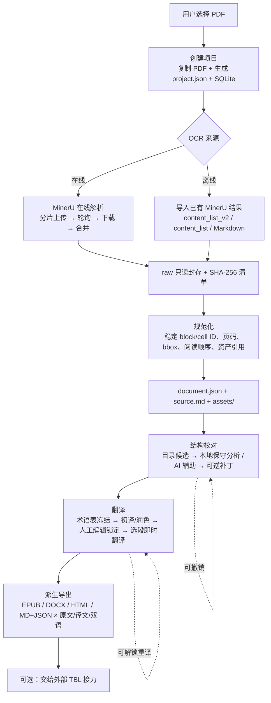

# Literature 项目文档

> 历史快照：正文整理于 2026-09-30，模块行数、默认路径、WebUI/桌面安排与验收项不再代表当前状态。2026-10-03 已切换到内置后端的 Tauri macOS 客户端；最新依据为 `PROJECT_PLAN.md`、`DEVELOPMENT_LOG.md`、`PACKAGING.md` 和 `RESOURCE_MANAGEMENT.md`。

> 标准项目文档 · 面向新加入者、评审者与后续开发者
>
> | 项目 | 内容 |
> |---|---|
> | 文档版本 | v1.0 |
> | 整理日期 | 2026-09-30 |
> | 对应代码版本 | `literature-workbench` 0.1.0（工作区状态，尚无 Git 提交） |
> | 事实来源 | 仓库源码、`docs/ARCHITECTURE.md`、`docs/DEVELOPMENT_LOG.md`、`docs/PACKAGING.md`、`pyproject.toml`、`src-tauri/`、界面设计稿 |
> | 状态标注约定 | ✅ 已实现并本地验证 · 🟡 已编码未真实验收 · ❌ 未实现 |

---

## 1. 项目概述

### 1.1 一句话定位

**Literature 是一个本地优先（local-first）的结构化文献处理工作台**：把 PDF 经 MinerU 解析后封存为只读证据，规范化为稳定的结构化文档图谱，并在其上提供目录校对、全书/章节/选段翻译与多格式导出。

### 1.2 目标用户与场景

- 需要把**扫描书 / 学术文献**转成可编辑、可翻译、可导出的结构化文档的研究者、译者与编辑。
- 关心**数据主权**：原书、译文、密钥全部留在本机，不上传第三方平台（除用户显式配置的 MinerU 与翻译模型 API）。
- 需要**可溯源**：任何一步处理都能回到 MinerU 原始输出与 PDF 的 bbox。

### 1.3 核心价值主张

| 主张 | 实现方式 |
|---|---|
| 主数据唯一 | `document.json` 是唯一长期事实来源，Markdown 只是投影 |
| 来源可溯源 | MinerU raw 只读封存 + SHA-256 清单校验 |
| 修改可回滚 | 结构校对只写可逆补丁，不直接改写正文 |
| 翻译不污染原文 | 译文通过 block/cell ID 挂接在独立译文层 |
| 导出可信 | 导出器只读规范图谱，**绝不**从原 PDF 生成成品 |
| 密钥不落地 | API Key / MinerU Token 存 macOS Keychain，不写入项目与日志 |

### 1.4 设计边界（明确不做）

1. MinerU 是首版**唯一** OCR 服务商；Literature 不实现 OCR 推理。
2. `ocr/raw/mineru/` 永不被规范化或翻译流程修改。
3. 首版不生成 PDF；不翻译图片内部文字。
4. TBL 以独立进程工作，只接收 Literature 导出的 EPUB/DOCX，**不回写** block 图谱。
5. 自动结构修改仅允许 `set_type` / `set_level`，且置信度阈值固定 0.97；不自动删除、合并、改写正文。

### 1.5 术语表

| 术语 | 含义 |
|---|---|
| raw / 封存层 | MinerU 原始输出，只读，带 `manifest.json` SHA-256 校验 |
| 规范化 / normalize | 把 MinerU 结果转成 `document.json` 的过程 |
| block | 文档图谱的最小结构单元（标题/正文/列表/表格/图片/公式/脚注） |
| cell | 表格 block 内的单元格，拥有独立稳定 ID |
| 结构补丁 StructurePatch | 对 block 类型/层级的可逆叠加修改记录 |
| 译文层 TranslationLayer | 按 block/cell ID 挂接的译文集合，与原文分离 |
| TBL | 外部接力工具，消费 Literature 导出的 EPUB/DOCX |
| sidecar | Local FastAPI 后端进程，由 Tauri 外壳拉起 |

---

## 2. 项目结构

### 2.1 仓库总览

```
literature/                                    (git 已初始化，尚无 commit)
├── pyproject.toml              Python 打包与依赖（fastapi/uvicorn/pydantic/httpx/python-docx/PyMuPDF）
├── README.md                   数据主线与设计边界（对外门面）
├── .gitignore
├── docs/
│   ├── PROJECT.md              ← 本文件：标准项目文档
│   ├── ARCHITECTURE.md         分层图 + 10 条长期不变量
│   ├── DEVELOPMENT_LOG.md      开发日志：已实现 / 已验证 / 未完成 / 下一步
│   ├── PACKAGING.md            macOS 打包流程
│   └── literature-structure-review.png   结构校对界面截图
├── literature/                 Python 后端（sidecar）
├── frontend/                   React 19 + Vite 7 + TypeScript 5.8 + PDF.js 5 前端
├── src-tauri/                  Tauri 2 桌面外壳（Rust）
├── scripts/build_sidecar.py    PyInstaller 单文件 sidecar 构建
├── tests/                      pytest 测试（16 项）
└── .venv/                      本地虚拟环境（gitignore）
```

### 2.2 后端模块职责（`literature/`，约 3.7k 行）

| 文件 | 行数 | 职责 | 关键入口 |
|---|---:|---|---|
| `mineru_workflow.py` | 1421 | **核心工作流**：MinerU 客户端、分片、轮询、下载、断点恢复、结果合并、Keychain Token、安全解压 | `MinerUClient`、`MinerUWorkflow`、`split_pdf`、`safe_extract_result` |
| `api.py` | 566 | Local FastAPI sidecar：约 50 个 REST 端点、会话令牌、CORS、后台 `JobManager`、SSE | `create_app()`、`main()` |
| `mineru.py` | 444 | 导入 `content_list_v2.json` / `content_list.json` / Markdown → 规范化图谱；稳定 ID、bbox、TOC、语言检测 | `import_mineru`、`normalize_imported_project` |
| `storage.py` | 348 | `ProjectStore`：项目目录、`project.json`、SQLite 账本、原子 JSON、哈希 | `ProjectStore` |
| `exporters.py` | 336 | HTML / MD+JSON / EPUB 3 / DOCX 四种派生导出 + EPUB 校验 | `export_all`、`validate_epub` |
| `translation.py` | 309 | 结构化翻译引擎：分块、术语表、prompt、严格 ID 回写校验 | `TranslationService` |
| `structure.py` | 260 | 目录页候选、本地保守分析、AI 结构校对、可逆补丁 | `analyze_structure`、`apply_patch`、`revert_patch` |
| `models.py` | 222 | 核心数据类与稳定 ID/摘要工具 | `Document`、`Block`、`Cell`、`StructurePatch`、`TranslationLayer`、`UsageRecord` |
| `providers.py` | 200 | OpenAI 兼容 provider 适配、Keychain 密钥管理、`MockProvider` | `OpenAICompatibleProvider`、`PROVIDER_PRESETS` |
| `ocr.py` | 107 | MinerU 服务适配层：作业创建/运行/重试/列表/状态映射 | `MinerUService` |
| `tbl.py` | 72 | TBL 外部接力桥（只送 EPUB/DOCX，不接收回写） | `TBLBridge` |
| `cli.py` | 48 | 命令行入口 `literature` | `main()` |
| `sidecar.py` | 7 | PyInstaller 打包入口 | — |

### 2.3 前端（`frontend/src/`）

| 文件 | 行数 | 职责 |
|---|---:|---|
| `App.tsx` | 239 | 应用壳 + 三大工作区 + 内联组件（`StructureQueue`/`JobPanel`/`GlossaryEditor`/`ExportPanel`/`TranslationBlock`/`InstantPanel`/`Settings`） |
| `PdfPage.tsx` | 41 | PDF 页面渲染 + bbox 联动选中 |
| `TocTree.tsx` | 11 | 目录树（勾选/定位） |
| `api.ts` | 31 | fetch 封装 + Tauri 会话令牌初始化 |
| `types.ts` | 22 | 前端类型定义 |
| `mineru.css` / `styles.css` | 91 / 1 | MinerU 风格主题（橙色主操作、半透明白面板）与基础样式 |

依赖：`@tauri-apps/api`、`@tauri-apps/plugin-dialog`、`pdfjs-dist@5`、`react@19`、`vite@7`。

### 2.4 桌面外壳（`src-tauri/`）

| 文件 | 职责 |
|---|---|
| `src/lib.rs` | 生成随机会话令牌；按 `LITERATURE_SIDECAR` → bundled sidecar → `LITERATURE_PYTHON` → `.venv/bin/python` → `python3` 顺序拉起 Python；应用退出时 kill 子进程；暴露 `session_token` 命令 |
| `src/main.rs` | 二进制入口 |
| `tauri.conf.json` | 产品名 Literature、窗口 1440×920、CSP 仅允许 `http://127.0.0.1:41731`、bundle target = `app` |
| `tauri.bundle.conf.json` | 发布态 `externalBin` 覆盖配置（含 sidecar） |
| `capabilities/default.json` | Tauri 2 权限能力 |
| `build.rs` / `gen/` / `icons/` | 构建脚本、schema、图标 |

### 2.5 运行时数据布局（每个项目一个目录，默认 `~/Documents/Literature/`）

```
<项目名>/
├── project.json          # 清单：project_id / title / 语言 / source_sha256 / budget_usd / state / 时间戳
├── literature.sqlite     # 账本：structure_patches / jobs / usage_records
├── source/origin.pdf     # 原 PDF（仅用于 OCR 输入与人工对照）
├── ocr/raw/mineru/       # 只读封存层 + manifest.json（SHA-256）
├── document/
│   ├── document.json     # ★ 唯一长期结构主数据
│   └── source.md         # 可读投影（派生，非事实来源）
├── translations/         # 译文层（按 block/cell ID 挂接）
├── assets/               # 图片等资源
└── exports/              # 派生导出物
```

应用级配置（provider 设置、TBL 命令与 URL）保存在 macOS Application Support 目录，**不进项目主数据**；密钥保存在 macOS Keychain。

---

## 3. 产品业务流程

### 3.1 端到端主流程



**关键约束**：图中从 `H` 之后的任何环节都只读取 `document.json`、译文层与 `assets/`；导出链在 `source/origin.pdf` 被删除的情况下也必须能完成（已作为测试断言固化）。

### 3.2 阶段明细

| # | 阶段 | 输入 | 输出 | 人工决策点 | 失败与恢复 |
|---|---|---|---|---|---|
| 0 | 项目创建 | PDF 绝对路径 | 项目目录、`project.json`、SQLite | 标题、源/目标语言、预算 | 非 PDF 直接拒绝 |
| 1 | OCR 接入 | 原 PDF 或已有 MinerU 结果 | raw 封存层 + manifest | 模型版本、语言包、OCR/表格/公式开关、每片页数 | 分片级断点恢复；支持 retry / pause |
| 2 | 规范化 | raw | `document.json` + `source.md` + `assets/` | —（仅校验） | raw 被篡改时哈希校验失败并报错 |
| 3 | 结构校对 | 目录基准 + 图谱 | 结构补丁（可逆） | **必须**确认目录页候选与低置信建议 | 逐项撤销 / 批量撤销；AI 只做 `set_type`/`set_level` 且 ≥0.97 自动应用 |
| 4 | 翻译 | block 范围 + 术语表 + provider | 译文层条目 + 用量记录 | 翻译范围、术语表、附加要求、预算 | 任务暂停/恢复；失败 chunk 记录为 `failed` 并可重试；预算耗尽自动暂停 |
| 5 | 导出 | 图谱 + 译文层 + assets | EPUB 3 / DOCX / HTML / MD+JSON | 内容模式（原文/译文/双语）与格式 | EPUB 结构校验；导出不改动任何上游数据 |
| 6 | TBL 接力 | 导出的 EPUB/DOCX | 独立 TBL 进程与 URL | 启动命令与本地 URL | 单向：TBL 不写回 Literature |

### 3.3 状态机

- **项目状态**（`project.json.state`）：`created` → `ocr_queued` → `ready`
- **OCR 作业状态**（`JobState`）：`queued` → `running` → `completed` / `failed` / `paused`……并含分片状态 `SliceState`
- **翻译作业**：`queued` / `running` / `paused` / `budget_paused` / `failed` / `completed`（`kind` ∈ `translate` / `refine`）
- **译文条目**：`pending` / `translated` / `failed`，人工编辑后 `locked=true`，批量任务默认跳过锁定项

### 3.4 UI 工作区与流程映射

| 工作区 | 对应阶段 | 布局 |
|---|---|---|
| 项目库（进入前） | 0 | 项目卡片网格 + 「导入 PDF」 |
| **结构校对** | 2–3 | 左「结构与任务」（目录基准、候选页、补丁队列、处理状态）/ 中「文档预览」（PDF + bbox 联动）/ 右「解析结果」（结构块 / Markdown / JSON 三标签） |
| **阅读与翻译** | 4 | 左「翻译范围 + 术语表 + 任务面板」/ 中「原文」/ 右「译文（编辑即锁定）」+ 选段即时翻译浮层 |
| **导出** | 5–6 | 内容模式 + 格式复选 + 「准备 EPUB 并交给外部 TBL」/「启动外部 TBL」 |
| 设置（弹层） | 全局 | 语言与章节覆盖、翻译模型与单价、项目预算、附加要求、Keychain 密钥、MinerU Token、TBL 命令、用量明细 |

> ⚠️ **设计稿与当前实现的差异**：另有一版「**首页 / 文件资源 / 结构校对 / 阅读与翻译 / 导出**」五导航的界面设计稿，其「**上传与处理**」页包含多格式拖拽接入台（PDF / Office / 图片 / HTML）、解析模型下拉（MinerU VLM）、文档语言包、逐文件 MinerU 设置、待处理文件列表与「当前处理任务」汇总。
> 该页面**在当前代码中不存在**：前端只有「项目库 + 三工作区」，后端 `POST /projects` 只接受**单个 `.pdf`**，无批量队列与多格式入口。这是规划中的产品形态，详见 §5 问题 P1-1。

### 3.5 安全与不变量

**10 条长期不变量**（详见 `ARCHITECTURE.md`，此处摘要）：

1. MinerU raw 封存后不可修改，靠 `manifest.json` SHA-256 复核。
2. `document.json` 保存原始字段与资源映射，不以 Markdown 为唯一事实来源。
3. 同一份封存 raw 重复规范化时 block/cell ID 保持稳定。
4. 结构校准只写可逆补丁；正文删除/合并/改写不得自动执行。
5. 翻译按 block/cell ID 挂接，不写回 source block。
6. 人工编辑译文自动锁定，批量任务默认跳过。
7. 导出器不得读取 `source/origin.pdf` 生成内容。
8. API Key、MinerU Token、会话令牌不得进入项目、日志或导出。
9. 本地 API 只绑定 loopback；除 `/health` 外均需会话令牌。
10. TBL 只消费派生 EPUB/DOCX，不拥有或覆盖文档图谱。

---

## 4. 技术架构

### 4.1 分层

```text
Tauri 2 桌面外壳（Rust）
  ├─ 生成随机会话令牌（每进程唯一）
  ├─ 拉起 / 回收 Python sidecar
  └─ WebView: React 19 + PDF.js
            │  HTTP (127.0.0.1:41731) + X-Session-Token
            ▼
FastAPI sidecar（Python 3.12）
  ├─ api.py       路由 / 鉴权 / CORS / JobManager / SSE
  ├─ ocr.py       MinerU 适配
  ├─ mineru_workflow.py  上传·分片·轮询·合并·解压
  ├─ mineru.py    规范化 → document.json
  ├─ structure.py 结构校对 → 可逆补丁
  ├─ translation.py + providers.py → 译文层 + 用量
  ├─ exporters.py → EPUB / DOCX / HTML / MD+JSON
  └─ storage.py   项目目录 + SQLite 账本
            ▼
本地文件系统：项目目录 / SQLite / Keychain
```

### 4.2 API 端点清单（按域分组，共约 50 个）

| 域 | 端点 |
|---|---|
| 健康与项目 | `GET /health`、`GET·POST /projects`、`GET·PATCH /projects/{id}` |
| 文档与资源 | `GET /projects/{id}/document`、`GET /projects/{id}/source.pdf`、`GET /projects/{id}/assets/{name}` |
| MinerU | `POST /projects/{id}/mineru/import`、`GET /projects/{id}/mineru/verify`、`GET·PUT·DELETE /mineru/token` |
| OCR 作业 | `POST /projects/{id}/ocr/jobs`、`POST /ocr/jobs/{id}/{start,retry,pause}`、`GET /projects/{id}/ocr/jobs` |
| 结构校对 | `POST .../structure/analyze`、`.../structure/analyze-ai`、`.../structure/audit-payload`、`GET .../structure/toc-page-candidates`、`POST .../structure/patches`、`.../patches/batch`、`GET .../structure/patches`、`.../patches/{id}/revert`、`.../patches/revert-batch` |
| 术语表 | `GET /projects/{id}/glossary/draft`、`PUT /projects/{id}/translations/{locale}/glossary` |
| Provider | `GET /providers`、`PUT·DELETE /providers/{provider}/key` |
| 翻译 | `POST /projects/{id}/translation/jobs`、`.../jobs/{id}/{pause,resume}`、`GET .../translation/jobs`、`GET .../translations/{locale}`、`POST .../translate/instant`、`PUT .../translations/{block_id}`、`.../translations/{block_id}/unlock`、`.../translations/{block_id}/selections` |
| 用量 | `GET /projects/{id}/usage`、`GET /projects/{id}/usage/records` |
| 导出与 TBL | `POST /projects/{id}/exports`、`POST /projects/{id}/tbl/prepare`、`POST /tbl/start`、`GET·PUT /tbl/config`、`GET /tbl/status` |
| 事件 | `GET /projects/{id}/events`（SSE 状态流） |

### 4.3 数据模型（`models.py`）

`Cell` · `Block` · `TocNode` · `Page` · `Document` · `StructurePatch` · `TranslationEntry` · `TranslationLayer` · `UsageRecord`

核心设计：`Block` 携带 `block_id`、`page_index`、`bbox`、`type`、`level`、`cells`、`resource_refs`、`caption`、`footnote`、`raw`；`TranslationLayer` 以 `entries[block_id]` 挂接译文并保存 `glossary_snapshot`；`UsageRecord` 逐次记录 provider / model / tokens / 估价。

### 4.4 SQLite 账本（`literature.sqlite`）

| 表 | 用途 |
|---|---|
| `structure_patches` | 结构补丁：before/after JSON、置信度、来源（user/ai）、`reverted_at` |
| `jobs` | 各类作业：kind、scope、status、progress、config、error |
| `usage_records` | 逐次模型调用：provider、model、scope、input/output/cached/reasoning tokens、估价 |

### 4.5 支持的 Provider 与导出格式

- **翻译 Provider**：OpenAI · DeepSeek · 智谱 GLM · Qwen / 阿里云百炼 · 自定义 OpenAI 兼容端点 · `MockProvider`（测试用）
- **源语言**：自动检测 + 英语 / 日语 / 法语 / 德语人工指定，支持按章节覆盖
- **导出**：EPUB 3 · DOCX · HTML · Markdown + JSON 包，各支持 `source` / `translation` / `bilingual` 三种内容模式

---

## 5. 当前进展与存在的问题

### 5.1 进展总览

| 能力 | 状态 | 证据 |
|---|---|---|
| 数据主线（raw 封存 → 规范化 → 图谱 → 译文层 → 导出） | ✅ | `docs/DEVELOPMENT_LOG.md`；`tests/test_pipeline.py` |
| 独立项目库 + SQLite 任务/修订/用量账本 | ✅ | `storage.py`、`_init_database` |
| MinerU 分片上传 / 轮询 / 下载 / 断点恢复 / 结果合并 | ✅ | `mineru_workflow.py`、`tests/test_mineru_workflow.py` |
| MinerU 三种结果导入 + raw SHA-256 校验 | ✅ | `mineru.py`、`test_tampered_raw_is_detected` |
| 稳定 block/cell ID、页码、bbox、阅读顺序、资产引用 | ✅ | `test_import_preserves_raw_structure_and_assets` |
| 可逆结构补丁 + 0.97 自动修正边界 | ✅ | `structure.py`、`test_structure_autofix_is_reversible` |
| AI 结构校对输入审计（不发送正文） | ✅ | `test_structure_ai_payload_excludes_body_text` |
| 本地多语言目录页候选 | ✅ | `test_toc_page_candidates_are_local_and_multilingual` |
| 五家 Provider + Keychain 密钥 | 🟡 | 已编码，未用真实密钥做全量兼容性验收 |
| 全书/章节/block/选段共用翻译引擎 + 人工锁定 | ✅ | `test_translation_lock_usage_and_exports` |
| 术语表冻结 + 任务暂停/恢复/失败分块重试 + 预算暂停 | ✅ | `test_failed_chunk_is_recorded_and_can_be_resumed`、`test_budget_pauses_before_another_model_call` |
| 四种格式 × 三种内容模式导出 | ✅ | `exporters.py`、`test_translation_lock_usage_and_exports` |
| 导出链不依赖原 PDF | ✅ | 测试先删除 `source/origin.pdf` 再导出 |
| Local sidecar 会话令牌 / CORS / loopback 边界 | ✅ | `test_path_and_session_boundaries` |
| Tauri 外壳 + React/PDF.js 三工作区界面 | ✅ | `src-tauri/`、`frontend/`、本地浏览器交互验收 |
| TypeScript 类型检查 / Vite 构建 / `cargo check` | ✅ | `DEVELOPMENT_LOG.md` 记录 |
| PyInstaller sidecar + `.app` bundle + 签名公证 | ❌ | 脚本与配置已就绪，**从未实际执行** |
| 真实 500+ 页扫描书 + 真实 MinerU Token + 真实模型 Key 的端到端验收 | ❌ | `DEVELOPMENT_LOG.md`「外部验收所需输入」 |
| 多格式接入台（Office / 图片 / HTML）、批量任务队列、逐文件设置 | ❌ | 设计稿存在，代码中无对应实现 |

> 测试规模：`tests/` 共 16 个用例（`test_pipeline.py` 9 + `test_mineru_workflow.py` 5 + `test_api.py` 2），开发日志记录为 **16 passed**。
> 本次梳理为**只读**核对，未重新执行测试；如需基线数据请在本地运行 `pytest -q` 复核。

### 5.2 存在的问题与风险

#### P0 — 阻断级

| ID | 问题 | 影响 | 建议 |
|---|---|---|---|
| P0-1 | **Git 仓库无任何 commit**，所有目录均为 untracked | 无版本历史、无法回退、无法协作与代码评审；一次误操作即丢失全部工作 | 立即完成首次提交，并建立分支/提交规范 |
| P0-2 | **核心链路未做真实验收**：无真实 500+ 页扫描书、真实 MinerU Token、真实模型 Key 的端到端跑通记录；MinerU HTTP 客户端与 Provider 均无集成测试夹具 | 「已实现」与「真的能用」之间存在未知差距，模型/接口变更无法及时发现 | 编写可注入的 HTTP 集成测试夹具，再用真实凭据做 smoke test |
| P0-3 | **发布链未跑通**：未生成 PyInstaller sidecar、未构建 `.app`、无签名/公证、无干净机器安装测试 | 目前只能开发者在有 `.venv` 的机器上运行，无法交付他人 | 按 `docs/PACKAGING.md` 实际构建一次并记录结果 |

#### P1 — 重要

| ID | 问题 | 影响 | 建议 |
|---|---|---|---|
| P1-1 | **界面设计稿与实现不一致**：设计稿含「首页 / 文件资源 / 上传与处理」多格式接入台（PDF/Office/图片/HTML、MinerU VLM 模型选择、文档语言包、逐文件设置、待处理队列、任务汇总），代码中仅有「项目库 + 三工作区」，后端 `POST /projects` 只接受单个 `.pdf` | 产品形态与用户预期存在落差；多格式与批量能力缺失 | 明确设计稿是否为下一阶段目标；若是，需要后端新增多格式接入、批量队列与逐文件配置的数据模型 |
| P1-2 | **`mineru_workflow.py` 1421 行巨石**，混合了 HTTP 客户端、PDF 分片、作业状态机、Keychain、安全解压、结果合并 | 阅读与修改成本高、单测覆盖困难（现有测试只覆盖纯函数辅助项） | 拆分为 `mineru/client.py` / `slice.py` / `state.py` / `secrets.py` / `extract.py` |
| P1-3 | **无 CI、无静态检查**：仓库无 `.github/workflows`，无 ruff / mypy / eslint / prettier 配置 | 质量依靠人工；跨语言改动容易悄悄破坏构建 | 增加最小 CI（pytest + tsc + cargo check）与格式化/静态检查配置 |
| P1-4 | **术语表无版本浏览与回滚**：仅能冻结一份快照 | 术语调整后无法追溯与对比 | 术语表版本化 + 差异视图 |
| P1-5 | **无 Provider 并发与速率限制**；无任务花费预估 | 大规模翻译易触发限流；用户无法在下单前预估成本 | 增加并发/限速配置与「预计花费」预检 |
| P1-6 | **前端无路由、无状态库、无组件测试**，`App.tsx` 内联 7 个组件 | 随功能增长将快速变得难以维护 | 拆分组件目录，引入路由与状态管理，补组件测试 |

#### P2 — 改进项

| ID | 问题 | 影响 |
|---|---|---|
| P2-1 | 目标语言与 locale 在前端硬编码为 `zh-CN` | 无法直接产出其他目标语言 |
| P2-2 | SSE `/projects/{id}/events` 已实现，但前端仍用 1.5s 轮询 | 资源浪费、状态延迟 |
| P2-3 | SQLite 仅有 `CREATE TABLE IF NOT EXISTS`，无版本迁移机制 | 表结构变更会破坏既有项目 |
| P2-4 | 缺少项目管理能力：删除/重命名项目、打开导出目录、下载导出物 | 项目积累后无法清理 |
| P2-5 | 日文竖排、复杂跨页表格、脚注回流、超大图片资源未做真实样本回归 | 特定文献类型质量未知 |
| P2-6 | 前端 `dist/` 已构建产物存在于工作区但被 gitignore；`literature_workbench.egg-info/` 也在工作区 | 工作区噪音；发布一致性依赖本地手跑 |
| P2-7 | 无代码覆盖率基线（`.coverage` 已 gitignore 但从未生成） | 不知道测试真实保护范围 |

### 5.3 后续路线（建议顺序）

**里程碑 1 — 立即可做（无需外部条件）**
1. 完成首次 Git 提交，建立提交规范与分支策略。（P0-1）
2. 拆分 `mineru_workflow.py`，同步补齐其单元测试。（P1-2）
3. 加入最小 CI：`pytest` + `tsc --noEmit` + `cargo check`。（P1-3）
4. 补齐 SQLite 迁移机制与项目管理端点。（P2-3、P2-4）

**里程碑 2 — 需要真实凭据**
5. 为 MinerU 与各 Provider 编写可注入 HTTP 夹具，跑通集成测试。（P0-2）
6. 用真实 500+ 页扫描书 + 真实 Token/Key 完成端到端 smoke test 并记录结果。（P0-2）
7. 术语表版本回滚、并发/限速、花费预估。（P1-4、P1-5）

**里程碑 3 — 发布与产品化**
8. 实际生成 sidecar 与 `.app`，完成签名、公证、干净机器验收。（P0-3）
9. 依据设计稿评估并实施「上传与处理 / 文件资源」多格式接入台。（P1-1）
10. 前端组件化 + 路由/状态管理重构。（P1-6）

### 5.4 外部验收所需输入

- 一份代表性的 500 页以上扫描 PDF，以及英、日、法、德各至少一份小样。
- MinerU Token。
- 至少一个翻译模型 API Key；四家 provider 的最终兼容性测试需各自 Key。
- TBL 的实际可执行文件路径与启动参数。
- 若要发布给其他 Mac：Apple Developer ID 与公证凭据。

---

## 6. 附录

### 6.1 开发与运行命令

```bash
# 环境准备
python3.12 -m venv .venv
.venv/bin/pip install -e '.[dev]'

# 后端（浏览器开发态需与前端共用同一会话令牌）
LITERATURE_SESSION_TOKEN=literature-dev .venv/bin/python -m literature.api
# 默认 API: http://127.0.0.1:41731

# 前端
VITE_LITERATURE_TOKEN=literature-dev pnpm --dir frontend dev

# 测试与检查
.venv/bin/python -m pytest -q
pnpm --dir frontend build          # tsc + vite build
cd src-tauri && cargo check

# 打包（发布态，尚未实际执行过）
.venv/bin/pip install -e '.[dev,packaging]'
.venv/bin/python scripts/build_sidecar.py
cd frontend && pnpm install && pnpm build
cd ../src-tauri && cargo tauri build --config tauri.bundle.conf.json
```

Tauri 开发态会自动拉起 Python sidecar，无需手工启动后端。

### 6.2 文档索引

| 文档 | 内容 | 何时读 |
|---|---|---|
| `README.md` | 数据主线、设计边界、快速启动 | 第一次接触项目 |
| `docs/PROJECT.md`（本文件） | 结构、业务流程、进展、问题、路线 | 需要全局认识时 |
| `docs/ARCHITECTURE.md` | 分层图与 10 条长期不变量 | 改代码前确认约束 |
| `docs/DEVELOPMENT_LOG.md` | 逐条已实现/已验证/未完成与外部依赖 | 判断某能力是否真的可用 |
| `docs/PACKAGING.md` | macOS 打包流程与 sidecar 发现顺序 | 做发布时 |

### 6.3 维护约定

- 任何改变数据流、不变量或状态机的改动，**必须**同步更新 `docs/ARCHITECTURE.md` 与本文件 §3、§4。
- 本文件 §5.1 的「状态」列必须区分「已编码」「本地已验证」「真实环境已验证」三档，禁止合并表述。
- 服务器端与导出的密钥、Token、会话令牌一律不得出现在本文件或任何文档示例中。
